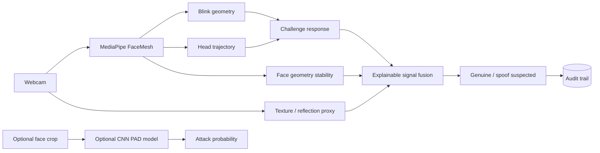

# TrueFace — Multi-Signal Anti-Spoofing Lab

**Status: Research security prototype**

[](https://github.com/rsswethaa/anti-spoofing-system/actions/workflows/ci.yml)

**[Live Demo](https://swethaa-trueface.onrender.com) · [Security Boundary](SECURITY.md) · [PAD Evaluation](docs/PAD_EVALUATION.md) · [Model Card](docs/MODEL_CARD.md)**

## The problem

A face-recognition screen is not useful if a printed photo or replayed video can satisfy it. TrueFace explores presentation-attack detection by combining **active user challenges** with several observable liveness signals rather than trusting one cue.

## What the prototype does

- tracks a face in the browser with MediaPipe FaceMesh
- runs active challenges such as **blink twice** and **turn your head**
- measures blink geometry and head movement
- monitors face-width stability as a geometry/depth-consistency proxy
- uses a lightweight frame-texture/reflection signal
- fuses the signals into an explainable liveness decision
- stores sessions, observations, challenges and decisions for auditability
- optionally scores cropped face images with a CNN research model
- includes APCER, BPCER and ACER evaluation utilities
- runs as a Flask/Docker application with automated tests and CI

## Why multi-signal fusion?

No single cue is reliable enough on its own. Blink detection can be replayed, texture proxies can be brittle, and geometry can vary with camera conditions. The prototype therefore exposes the individual components and combines them rather than hiding the decision behind one opaque output.

## Architecture



## PAD evaluation

A prediction CSV with `label,score,attack_type` can be evaluated with:

```bash
python research/evaluate_pad.py predictions.csv --threshold 0.5
```

The evaluator reports:

- APCER overall and by attack type
- BPCER
- ACER
- the exact threshold used

Those metrics are provided as evaluation tooling; this repository does **not** claim certification or benchmark performance without a legitimate evaluated dataset.

## Optional CNN research path

```bash
pip install -r requirements-cnn.txt
python research/train_cnn.py path/to/pad_dataset --epochs 10
```

Expected research classes include `bona_fide`, `print`, `replay` and `mask`. The trained research path writes `models/anti_spoof_cnn.pt` when a suitable dataset is supplied.

## API

- `POST /api/session` — start a blink/head-turn challenge
- `POST /api/session/<ref>/frame` — submit face landmarks and texture signal
- `POST /api/cnn/score` — optional CNN face-image scoring
- `GET /health` — service and model availability

## Run locally

```bash
python -m venv .venv
source .venv/bin/activate  # Windows: .venv\Scripts\activate
pip install -r requirements.txt
python app.py
```

Open `http://localhost:5000` and allow webcam access.

## Key engineering decisions

### Active challenge-response

A randomised user action gives the system a temporal signal that is harder to satisfy with a static image than passive appearance checks alone.

### Explainable components

The prototype exposes blink, motion, geometry, texture and challenge evidence separately so a reviewer can see why the decision moved.

### Heavy CNN path kept optional

The live product and CI remain reproducible without a large deep-learning stack, while the repository still provides a path for trained PAD experiments when an appropriate dataset is available.

## Security boundary

This is not production biometric security. It does not claim ISO/PAD certification, FAR/FRR guarantees or benchmark accuracy. Real deployment would require trusted capture, anti-injection controls, representative attack datasets, subject-disjoint/cross-dataset testing, calibrated thresholds, privacy safeguards and independent security assessment.

See [SECURITY.md](SECURITY.md) for the explicit threat and privacy boundary.
