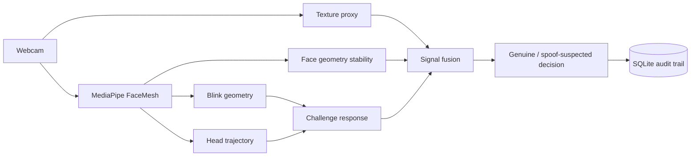

# TrueFace — Multi-Signal Anti-Spoofing Lab

A portfolio-grade **live liveness-authentication prototype**. TrueFace combines webcam FaceMesh landmarks, challenge-response behaviour and multiple explainable signals into a final liveness decision.

## Product capabilities
- live webcam face tracking using MediaPipe FaceMesh in the browser
- challenge-response sessions: **blink twice** or **turn head**
- blink detection from eye landmark geometry
- head-motion signal from normalised nose trajectory
- face-width stability as a geometry/depth-consistency proxy
- lightweight frame-texture proxy calculated in the browser
- weighted liveness fusion with visible score components
- authentication-style genuine / spoof-suspected UI
- SQLite persistence of sessions, observations, challenges and decisions
- Flask API, Docker packaging, product tests and CI

## Run
```bash
pip install -r requirements.txt
python app.py
```
Open `http://localhost:5000`, allow webcam access, and start a challenge. Browser MediaPipe assets are loaded from jsDelivr.

## Architecture


## Security integrity
This is not production biometric security and its texture/depth signals are intentionally lightweight. It does not claim PAD certification or benchmark accuracy. A production extension would need attack-specific datasets (print, replay, mask and injection attacks), APCER/BPCER evaluation, device integrity, secure capture, model calibration and adversarial testing.
