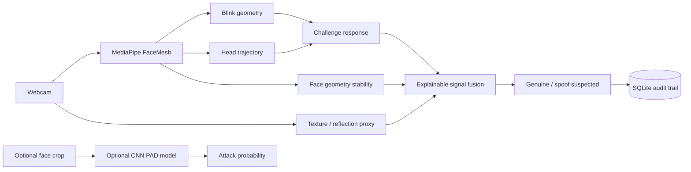

# TrueFace — Multi-Signal Anti-Spoofing Lab

[](https://github.com/rsswethaa/anti-spoofing-system/actions/workflows/ci.yml)

A portfolio-grade live liveness-authentication prototype combining webcam FaceMesh landmarks, challenge-response behaviour, explainable signal fusion and an optional CNN presentation-attack classifier.

## Product capabilities
- live webcam face tracking using MediaPipe FaceMesh in the browser
- login-style challenge-response sessions: **blink twice** or **turn head**
- blink detection from eye landmark geometry
- head-motion signal from normalised nose trajectory
- face-width stability as a geometry/depth-consistency proxy
- lightweight frame-texture / screen-reflection proxy
- weighted liveness fusion with visible score components
- genuine / spoof-suspected authentication UI
- SQLite persistence of sessions, observations, challenges and decisions
- optional CNN liveness scoring endpoint
- research training path for bona-fide vs print/replay/mask attacks
- APCER, BPCER, ACER and per-attack-type evaluation utilities
- Flask API, Docker packaging, tests and CI

## Architecture


## Run the live product
```bash
python -m venv .venv
source .venv/bin/activate  # Windows: .venv\Scripts\activate
pip install -r requirements.txt
python app.py
```
Open `http://localhost:5000`, allow webcam access and start a challenge. Browser MediaPipe assets are loaded from jsDelivr.

## Optional CNN research path
```bash
pip install -r requirements-cnn.txt
python research/train_cnn.py path/to/pad_dataset --epochs 10
```

Expected research classes include `bona_fide`, `print`, `replay` and `mask`. The trainer maps attack classes to the binary attack target and writes `models/anti_spoof_cnn.pt`.

Once a model exists, the product exposes:

- `POST /api/cnn/score` — upload one cropped face image and receive bona-fide / attack probabilities.

This CNN path is deliberately optional so the live challenge-response product and CI remain reproducible without heavyweight deep-learning downloads.

## PAD evaluation
Use a prediction CSV with `label,score,attack_type` and run:

```bash
python research/evaluate_pad.py predictions.csv --threshold 0.5
```

The evaluator reports:
- APCER overall and by attack type
- BPCER
- ACER
- the exact decision threshold

See `docs/PAD_EVALUATION.md` for protocol guidance.

## API
- `POST /api/session` — start blink/head-turn liveness challenge
- `POST /api/session/<ref>/frame` — submit face landmarks and texture signal
- `POST /api/cnn/score` — optional CNN face-image scoring
- `GET /health` — service and CNN-model availability

## Repository structure
```text
app.py                 live liveness product/API
static/, templates/    webcam/login-style UI
src/live_session.py    blink, motion, challenge and geometry logic
src/liveness.py        signal-fusion baseline
src/cnn_liveness.py    optional CNN inference adapter
src/pad_metrics.py     APCER/BPCER/ACER evaluation
research/train_cnn.py  deep-learning training path
research/evaluate_pad.py PAD metrics CLI
database/              session/observation/challenge/decision audit store
tests/                 liveness, storage, product and PAD-metric tests
docs/                  architecture, API, database, security, model card, report and PAD evaluation
```

## What I learned
This project demonstrates browser computer vision, liveness challenge design, explainable multi-signal fusion, biometric audit logging, optional CNN integration, presentation-attack metrics, threat modelling, Flask APIs, Docker and CI.

## Security integrity
This is not production biometric security and does not claim PAD certification or benchmark accuracy. A production system requires representative attack datasets, subject-disjoint and cross-dataset testing, APCER/BPCER calibration, secure camera capture, anti-injection/device controls, privacy safeguards and independent security assessment.
