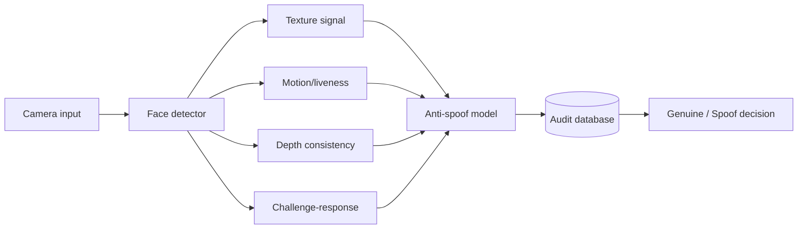

# Anti-Spoofing System

A complete deep-learning-inspired presentation-attack detection portfolio system combining liveness evidence, auditable decisions, persistent sessions, testing and security documentation.

## Included
- explainable texture, motion, depth-consistency and challenge-response feature fusion
- configurable spoof/genuine decision threshold
- synthetic attack/genuine examples
- SQLite persistence for liveness sessions, signal observations, challenges and final decisions
- ER and data-flow diagrams
- automated model and storage tests
- CI
- interface, deployment, security and model-card docs
- full technical report

## Architecture


## Run
```bash
python demo.py
python -m unittest discover -s tests -v
```

## Database
```bash
python -c "from src.storage import init_db; init_db('antispoof.db', seed=True)"
```

## Security boundary
This is an educational portfolio prototype, not a certified biometric security control. No APCER/BPCER, FAR/FRR, ISO compliance or production assurance claim is made.
