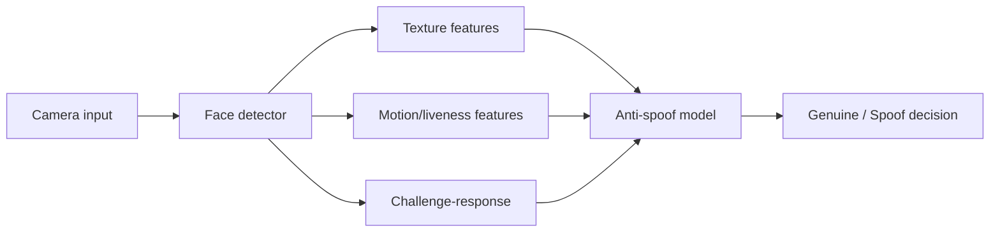

# Anti-Spoofing System

A deep-learning-inspired presentation-attack detection portfolio project that models how liveness, texture and challenge-response signals can be combined to distinguish genuine users from spoof attempts.

## Features
- explainable liveness feature vector
- texture, motion and challenge-response signals
- configurable decision threshold
- spoof/genuine confidence score
- synthetic test cases
- CI, architecture and technical report

## Architecture


## Run
```bash
python demo.py
python -m unittest discover -s tests -v
```

## Security note
This is an educational portfolio prototype, not a production biometric security control. It does not claim certified presentation-attack detection performance.
