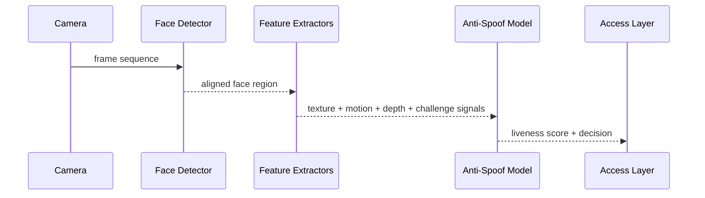

# Architecture

The reference implementation keeps feature fusion transparent and deterministic. A full DL research system could use CNN/Transformer-based presentation-attack detection trained on consented datasets and evaluated across print, replay, mask and adversarial conditions.
