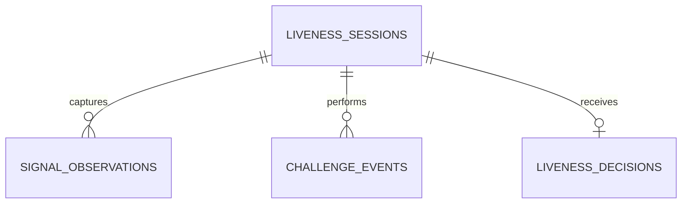

# Database Design

## Tables
- `liveness_sessions`: pseudonymous transaction/session and device reference.
- `signal_observations`: texture, motion and depth evidence.
- `challenge_events`: active-liveness challenge outcome.
- `liveness_decisions`: final versioned label, score, threshold and explanation.

Persisting evidence separately from the final decision supports post-event review and model-version auditing.
